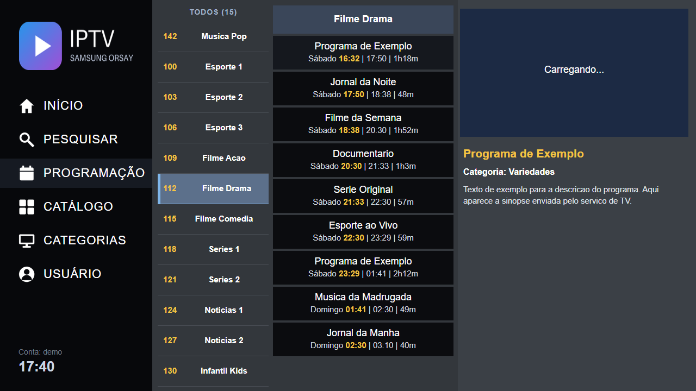
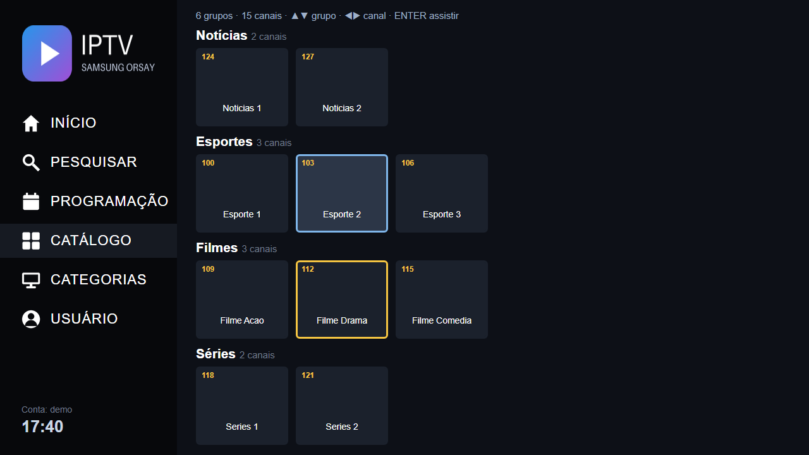
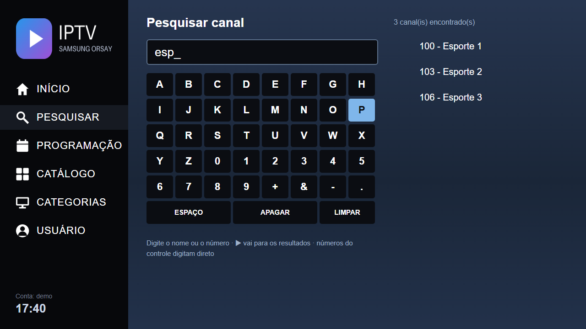
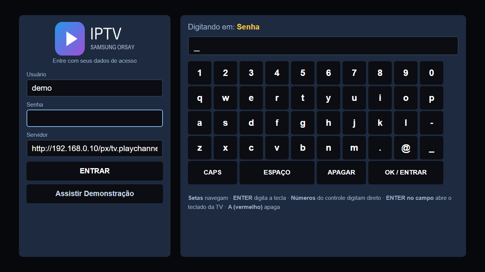

# Play Channel para Samsung Smart TV (Orsay, 2012–2014)

Cliente **não oficial** de TV ao vivo para Smart TVs Samsung antigas, aquelas que não têm mais loja de aplicativos e cujo navegador não abre sites modernos. Guia de programação, catálogo por grupos, pesquisa, controle parental e troca rápida de canais, tudo feito para o controle remoto.

<p align="center">
  
  
  
  
</p>

> **Aviso.** Projeto independente da comunidade. **Não é afiliado, patrocinado nem aprovado** pela Samsung nem pelo Play Channel. Ele **não fornece canais nem conteúdo**: você precisa de uma conta sua em um serviço compatível. Usa a API do serviço, que não é documentada e pode mudar. Use por sua conta e risco e respeite os termos do serviço que você contratou.

## Índice
1. [A TV é compatível?](#1-a-tv-é-compatível)
2. [Como funciona](#2-como-funciona)
3. [Instalação passo a passo](#3-instalação-passo-a-passo)
4. [Usando o app](#4-usando-o-app)
5. [Personalizar](#5-personalizar)
6. [Segurança e privacidade](#6-segurança-e-privacidade)
7. [Problemas comuns](#7-problemas-comuns)
8. [Desenvolvimento e testes](#8-desenvolvimento-e-testes)

---

## 1. A TV é compatível?

O widget roda na plataforma **Orsay**, usada pela Samsung de 2011 a 2014. A letra da série está no código do modelo (ex.: `UN40`**`H`**`5203`, `UE46`**`F`**`6400`):

| Série (letra) | Ano | Plataforma | Situação |
|---|---|---|---|
| **H** | 2014 | Orsay | **Testado** (uma TV, série H, região Brasil) |
| **F** | 2013 | Orsay | Deve funcionar (não testado) |
| **E** | 2012 | Orsay | Deve funcionar (não testado) |
| C, D | 2010–2011 | Orsay antigo | Possível, mas provavelmente exige ajustes |
| **J, K, M, N, Q, R, T…** | 2015 em diante | **Tizen** | **Não compatível** (use o app oficial ou outro projeto) |

Também é preciso:
- um **computador ou mini-servidor sempre ligado na mesma rede** da TV, com [Docker](https://docs.docker.com/get-docker/) (Windows, Linux ou Raspberry Pi servem). Ele roda a "ponte" explicada abaixo;
- uma **conta no serviço** de TV;
- **Python 3** no computador onde você vai montar o pacote (para o `tools/build.py`).

Se você testar em outra série, abra uma *issue* contando o resultado. Isso ajuda a completar a tabela.

## 2. Como funciona

```
 TV Samsung ──HTTP──▶  seu servidor (Docker)  ──HTTPS──▶  serviço de TV
 (widget Orsay)        nginx + miniaturas                  (API e vídeo HLS)
```

Por que precisa de um servidor? O navegador dessas TVs usa uma biblioteca de segurança de 2012 (GnuTLS 2.12) que **não consegue abrir os sites HTTPS de hoje**. Sem a ponte, o login falha para sempre em "Conectando...". O servidor também:

- **distribui o widget** para a TV (sincronização de rede do modo desenvolvedor);
- **reduz os logos** dos canais para o tamanho exato da tela. Os originais têm ~3500×3300 px e 1,7 MB cada, e a TV engasgava e mostrava tudo serrilhado. As miniaturas pesam ~1,5 KB.

O vídeo toca no **player de hardware** da TV (decodificação por chip), não no HTML.

## 3. Instalação passo a passo

### 3.1 Subir o servidor

No computador/servidor da rede local (anote o IP dele, por exemplo `192.168.0.10`; é melhor reservá-lo no roteador para não mudar):

```bash
git clone https://github.com/joaopssouza/playchannel-samsung-orsay.git
cd playchannel-samsung-orsay

# 1) Monta o widget com o IP do SEU servidor
pip install pillow                 # só para gerar as imagens (passo opcional abaixo)
python tools/build.py --server http://192.168.0.10

# 2) Sobe a ponte + servidor de widgets (porta 80)
cd server
docker compose up -d --build
```

Teste no navegador de outro aparelho da rede:

- `http://192.168.0.10/widgetlist.xml` deve mostrar um XML;
- `http://192.168.0.10/px/tv.playchannel.com.br/assets/json/config.json` deve mostrar `{"version": ...}`.

> A porta tem que ser a **80**: é a que a TV usa na sincronização. Se ela estiver ocupada no servidor (outro nginx, por exemplo), libere-a ou adapte o seu proxy com base em `server/nginx/default.conf.template`.

### 3.2 Ativar o modo desenvolvedor e sincronizar na TV

Os nomes dos menus variam um pouco entre séries e idiomas. Em linhas gerais:

1. Pressione **Smart Hub** no controle e entre em *Samsung Account → Login*.
2. Entre com o usuário **`develop`** (conta de desenvolvedor da Samsung; a senha para a sua série está na documentação do SDK Samsung Smart TV 2014 e em fóruns de Orsay).
3. Com a conta logada, abra **Ferramentas (TOOLS) → Configurações → Desenvolvimento**.
4. Em **Configuração de IP do servidor**, digite o IP do servidor (`192.168.0.10`).
5. Escolha **Sincronização de aplicativos do usuário**. A TV baixa o widget e ele aparece no Smart Hub, em "Meus aplicativos" (ou "Recente").

Para atualizar depois de gerar uma versão nova, repita o passo 5 (se necessário, apague o app antigo antes).

**Alternativa por pendrive:** copie o conteúdo de `dist/usb/` para uma pasta `userwidget` na raiz de um pendrive FAT32 e espetre na TV.

### 3.3 Entrar

Abra o app, digite **usuário e senha** do seu serviço com o teclado da tela ou com os números do controle, e escolha **ENTRAR**. O campo *Servidor* já vem preenchido com a ponte; não precisa mexer.

### 3.4 (Opcional) Usar seu próprio logo

As imagens que acompanham o projeto são uma marca genérica. Para usar a sua:

```bash
python tools/make_assets.py --logo meu_logo.png   # PNG com fundo transparente
python tools/build.py --server http://192.168.0.10
```

## 4. Usando o app

| Tecla do controle | O que faz |
|---|---|
| ▲ ▼ ◀ ▶ | Navega (as listas dão a volta: ▲ no primeiro vai para o último) |
| **ENTER** | Assiste / abre / confirma (no canal que já está tocando abre a tela cheia) |
| **RETURN** | Volta um passo |
| **CH ▲/▼** ou ▲▼ em tela cheia | Troca de canal (o vídeo abre quando você para de apertar) |
| **0–9** | Digita o número do canal; na pesquisa digita direto |
| **PRE-CH** | Volta ao canal anterior |
| **A** (vermelho) | Alterna entre guia e tela cheia; apaga letras na pesquisa |
| **B** (verde) | Lista rápida de canais sobre o vídeo |
| **C** (amarelo) | Sair da conta |
| **D** (azul) | Atualizar a lista de canais |
| VOL / MUTE | Volume da TV (a TV mostra a barra) |

Menu lateral: **Início**, **Pesquisar** (nome ou número, sem diferenciar acentos), **Programação** (guia com a grade do canal), **Catálogo** (canais em fileiras por grupo: TV Aberta, Filmes, Esportes, Infantil, Desenhos 24 Horas…), **Categorias** e **Usuário** (sair da conta, atualizar canais, trocar a senha do controle parental).

O app também: abre no **último canal assistido**, **reconecta sozinho** se o stream cair, **renova o login** antes dos 5 h de validade, mostra uma tela própria para canais **somente áudio** (rádios) e mantém a hora certa mesmo que o relógio da TV esteja errado.

**Controle parental:** canais 18+ pedem uma senha de 4 dígitos (padrão `0000`; troque em *Usuário → Alterar senha*).

## 5. Personalizar

| O quê | Onde |
|---|---|
| Domínio do serviço | `server/.env` (`PROVIDER_HOST`) e `widget/js/config.js` (`providerHost`) |
| Regras dos grupos do Catálogo | `GROUP_RULES` em `widget/js/app.js` |
| Cores | `widget/css/style.css` (paleta no cabeçalho do arquivo) |
| Outros hosts liberados na ponte | último `location` de `server/nginx/default.conf.template` |

> **Cuidado ao editar `.js`:** a TV lê os arquivos como Latin-1. Acentos têm de ser escritos como escape Unicode (barra, `u` e 4 dígitos hex; `ç` = `00E7`). O `tools/build.py` recusa empacotar se achar um acento literal. Detalhes em [`docs/ORSAY-NOTES.md`](docs/ORSAY-NOTES.md).

## 6. Segurança e privacidade

- **Nada de segredos no repositório.** Usuário e senha são digitados na TV. O endereço do servidor é gravado no pacote só na hora do `build`.
- O app guarda na memória da **TV** o *token* e a senha (para renovar o login sozinho). **"Sair da conta" apaga ambos.**
- ⚠️ **O trecho TV → servidor é HTTP**, sem criptografia (a TV não suporta mais). Seu usuário e senha trafegam em texto puro **dentro da sua rede local**. Use só em rede doméstica de confiança.
- ⚠️ **Não exponha a porta 80 à internet.** A ponte só atende endereços privados (`10.x`, `172.16–31.x`, `192.168.x`), mas o ideal é nem encaminhar a porta no roteador.
- Se você fez capturas de rede (arquivos `.har`) para estudar o serviço, **elas contêm sua senha**. Não as publique.

## 7. Problemas comuns

| Sintoma | Causa provável e solução |
|---|---|
| Fica em "Conectando..." ou dá "Sem conexão" | A TV não alcança o servidor. Teste o `widgetlist.xml` no navegador de outro aparelho; confira o IP usado no `build` e se o `docker compose` está de pé (`docker compose ps`). |
| "Usuário ou senha incorretos" | Confira as credenciais no site do serviço. Usuário e senha diferenciam maiúsculas. |
| "Limite de sessões atingido" | O serviço limita telas simultâneas. Feche o app em outro aparelho e aguarde 1–2 minutos. |
| Logos demoram só na primeira vez | O servidor está gerando as miniaturas. Depois ficam em cache. |
| Horários da programação errados | O app usa o horário de Brasília (UTC−3). Para outro fuso, ajuste `TZ_OFFSET_MIN` em `widget/js/app.js`. |
| Acentos viram `ç` | Algum `.js` ficou com acento literal. Rode `python tools/build.py` e siga a mensagem. |
| Vídeo preto em canal de rádio | Esperado: o app mostra uma tela de "Somente áudio"; o som toca normalmente. |
| Mais dicas | [`docs/TROUBLESHOOTING.md`](docs/TROUBLESHOOTING.md) |

## 8. Desenvolvimento e testes

```
widget/   o aplicativo (HTML + CSS + JavaScript ES5, sem frameworks)
server/   docker-compose: nginx (ponte e distribuição) + serviço de miniaturas (Python/Pillow)
tools/    build.py (empacota) e make_assets.py (gera imagens)
tests/    testes em jsdom que simulam a TV (Common API, plugin do player, teclas)
docs/     notas técnicas sobre a plataforma Orsay
```

```bash
cd tests && npm install && npm test      # ~85 verificações, sem precisar de TV nem de rede
```

Para testar no PC sem TV, abra `widget/index.html` num navegador com `widget/js/hls.light.min.js` (baixe com `python tools/get_hlsjs.py`). Nesse modo o app usa `<video>` + hls.js em vez do player da TV.

Contribuições são bem-vindas, principalmente **relatos de modelos testados** e correções para outras séries Orsay.

## Licença

[MIT](LICENSE). As marcas citadas pertencem aos seus donos.
